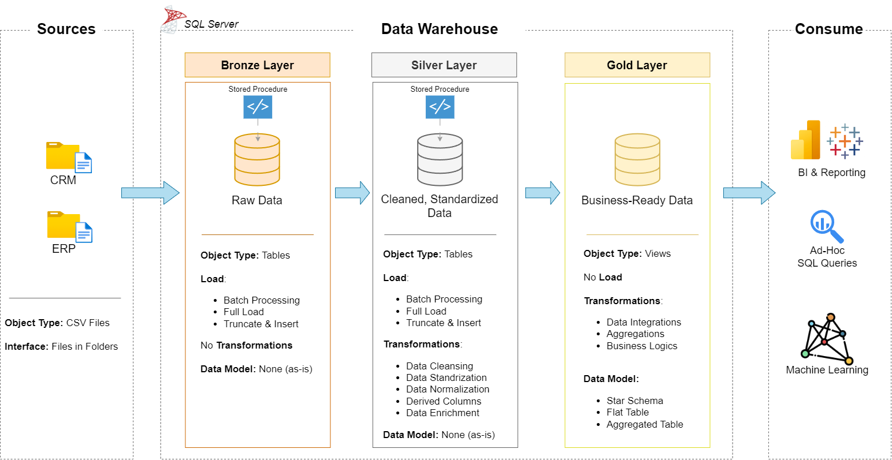
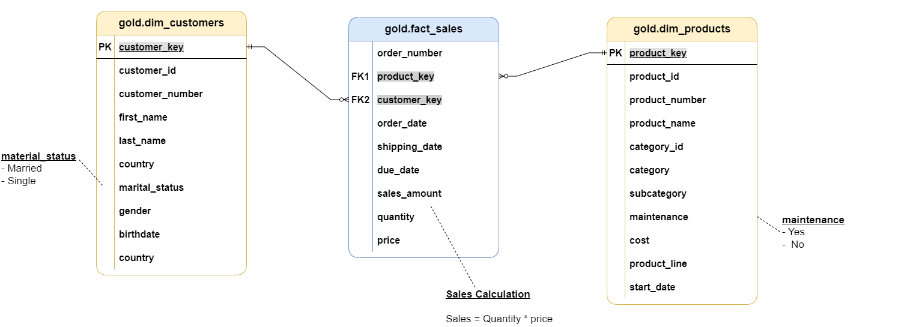

# SQL Data Warehouse

An end-to-end data warehouse in SQL Server that combines sales data from two source systems (CRM and ERP) into one star schema ready for reporting.

I built this by working through Data With Baraa's SQL data warehouse course, writing and running every script myself. Below is what the warehouse does and the decisions inside it.



## The data

Six CSV files from two systems, about 116,000 rows in total:

| Source | Files | What they hold |
|---|---|---|
| CRM | `cust_info`, `prd_info`, `sales_details` | Customers, products, about 60,000 sales lines |
| ERP | `CUST_AZ12`, `LOC_A101`, `PX_CAT_G1V2` | Customer birthdates and gender, countries, product categories |

## Architecture: Bronze, Silver, Gold

| Layer | What happens | Built with |
|---|---|---|
| **Bronze** | Raw data loaded as-is from the CSV files | Stored procedure using `BULK INSERT`, with `TRY/CATCH` error handling and load-time logging |
| **Silver** | Cleaned and standardised | Deduplication with `ROW_NUMBER`, product end dates derived with `LEAD`, `CASE` rules for codes like gender and marital status, trimming and type fixes |
| **Gold** | Business-ready star schema | Views: `fact_sales`, `dim_customers`, `dim_products`, with surrogate keys |



## Data quality checks

`tests/` holds SQL checks run after each load: duplicate and null keys, unwanted spaces, invalid dates, and sales amounts that do not equal quantity times price.

## Repository structure

```
datasets/      Source CSV files (CRM and ERP)
docs/          Architecture, data flow and data model diagrams, data catalog, naming conventions
scripts/
  init_database.sql   Creates the database and schemas
  bronze/             Bronze tables and load procedure
  silver/             Silver tables and cleaning procedure
  gold/               Star schema views
tests/         Quality checks for Silver and Gold
```

## Run it

1. Install SQL Server Express and SQL Server Management Studio.
2. Run `scripts/init_database.sql`.
3. Run the DDL scripts, then `EXEC bronze.load_bronze;` and `EXEC silver.load_silver;` (update the CSV file paths in the Bronze procedure first).
4. Run `scripts/gold/ddl_gold.sql`, then the checks in `tests/`.

## License

MIT
